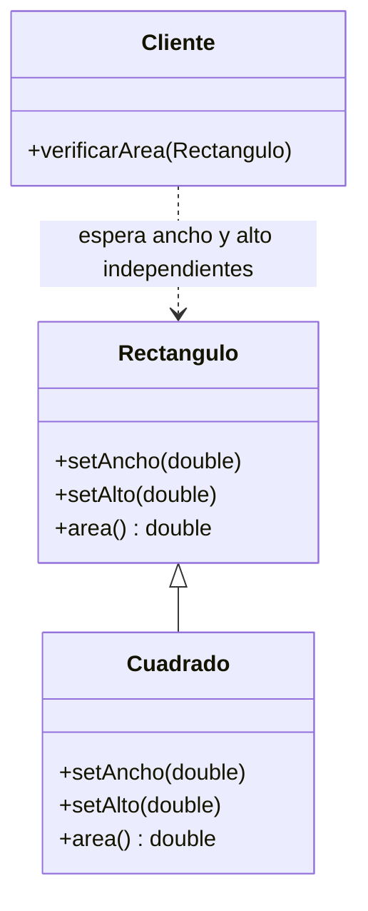
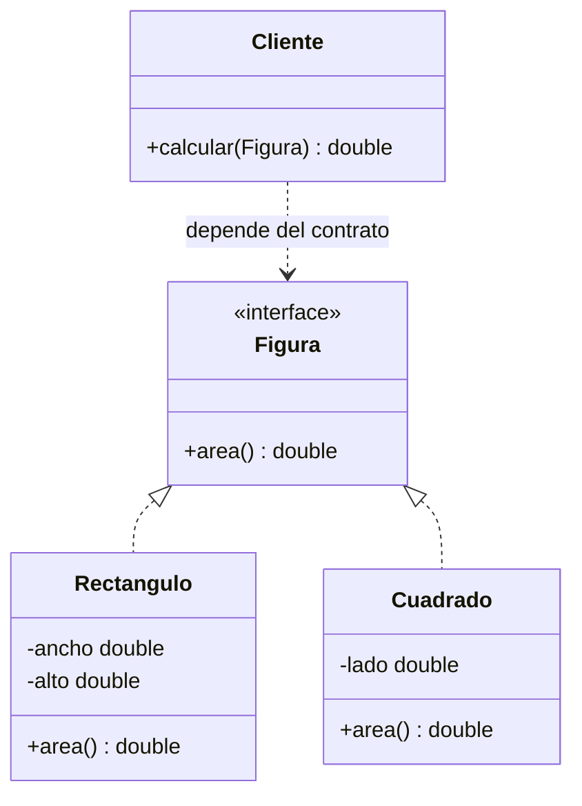

# Investigación: principio de sustitución de Liskov en Java

**Formato:** guion de diapositivas · **Área:** diseño orientado a objetos en Java  
**Nota:** “Liskop” parece ser una errata de **Liskov**. Se conoce como principio de sustitución de Liskov (LSP) o subtipado conductual; no es un método paso a paso.

---

## Diapositiva 1 — El LSP en el contexto de Java

**Idea central:** un objeto de una subclase debe poder usarse donde se espera la clase base sin romper las expectativas del programa.

En Java, esto afecta a clases derivadas con `extends` y a implementaciones de interfaces con `implements`. El compilador verifica reglas de tipos y sobrescritura; el LSP exige además que el comportamiento siga siendo compatible.

**Pregunta de investigación:** ¿cómo usar herencia e interfaces en Java sin sorprender al código cliente?

---

## Diapositiva 2 — Objetivo y método de investigación

- **Objetivo:** explicar el origen, las reglas y la aplicación del LSP en programas Java.
- **Método:** revisión documental de los trabajos de Liskov (1987), Liskov y Wing (1994), y la especificación oficial del lenguaje Java.
- **Alcance:** diseño de jerarquías de clases, sobrescritura de métodos e interfaces.
- **Hallazgo principal:** que una clase compile y use `@Override` no garantiza por sí solo que respete el contrato conductual de su supertipo.

---

## Diapositiva 3 — Origen y evolución

- En **1987**, Barbara Liskov presentó la propiedad de sustitución al estudiar abstracción de datos y jerarquías.
- En **1994**, Barbara Liskov y Jeannette Wing desarrollaron una definición formal de subtipado conductual.
- La propuesta considera contratos, invariantes y cambios de estado, no solo nombres o firmas de métodos.

**Lectura para Java:** `extends` describe una relación de tipos en el lenguaje; el diseño debe justificar además que la subclase mantenga las promesas de la clase base.

Fuentes: [Liskov, 1987](https://doi.org/10.1145/62139.62141) · [Liskov y Wing, 1994](https://doi.org/10.1145/197320.197383).

---

## Diapositiva 4 — Qué significa sustituir en Java

Una variable declarada con el tipo base puede referirse a un objeto de una subclase:

```java
Figura figura = new Circulo(3.0);
double resultado = figura.area();
```

El cliente llama al contrato visible en `Figura`; durante la ejecución Java selecciona la implementación sobrescrita de `Circulo`.

**LSP:** el resultado y los efectos deben cumplir las expectativas que el cliente formó usando el tipo `Figura`.

---

## Diapositiva 5 — Contratos que la subclase debe respetar

1. **Precondiciones:** no exigir entradas más restringidas que las permitidas por el tipo base.
2. **Postcondiciones:** cumplir lo que el tipo base promete sobre el resultado.
3. **Invariantes:** mantener las condiciones que deben ser ciertas para el objeto.
4. **Estado e historial:** permitir secuencias de operaciones coherentes con el contrato base.
5. **Excepciones:** evitar respuestas o errores incompatibles con lo que espera el cliente.

Regla mnemotécnica: **no fortalecer precondiciones ni debilitar postcondiciones**. El análisis formal también considera invariantes y propiedades históricas.

Fuente: [Liskov y Wing, 1994](https://doi.org/10.1145/197320.197383).

---

## Diapositiva 6 — Ejemplo Java que viola el LSP

El cliente espera que ancho y alto se puedan cambiar independientemente:

```java
static void verificarArea(Rectangulo figura) {
    figura.setAncho(5);
    figura.setAlto(4);
    if (figura.area() != 20) {
        throw new AssertionError("Área inesperada");
    }
}
```

Si `Cuadrado extends Rectangulo` y cada setter actualiza ambos lados, el área final será **16**, no **20**.

**Diagnóstico:** la subclase compila, pero contradice una expectativa válida creada por la interfaz mutable de `Rectangulo`. La relación geométrica “un cuadrado es un rectángulo” no basta para justificar esa herencia de implementación.



**Lectura del diagrama:** el cliente programa contra `Rectangulo`; los setters redefinidos por `Cuadrado` cambian esa expectativa.

---

## Diapositiva 7 — Diseño Java basado en una interfaz

Si el código cliente solo necesita calcular áreas, puede depender de una interfaz pequeña:

```java
interface Figura {
    double area();
}

final class Rectangulo implements Figura {
    private final double ancho, alto;
    Rectangulo(double ancho, double alto) {
        this.ancho = ancho;
        this.alto = alto;
    }
    @Override public double area() { return ancho * alto; }
}

final class Cuadrado implements Figura {
    private final double lado;
    Cuadrado(double lado) { this.lado = lado; }
    @Override public double area() { return lado * lado; }
}
```

`Rectangulo` y `Cuadrado` comparten el contrato `Figura.area()` y cada uno preserva sus propias reglas. El cliente puede recibir ambos como `Figura` sin depender de setters incompatibles.



**Lectura del diagrama:** las dos clases implementan `Figura`; el cliente depende solo del método `area()`.

---

## Diapositiva 8 — Qué comprueba Java y qué no

**El compilador comprueba, entre otras reglas:**

- que `@Override` corresponda a un método que realmente se sobrescribe;
- compatibilidad de tipos de retorno, incluido el retorno covariante;
- que una sobrescritura no declare excepciones comprobadas más amplias que el método base.

**El compilador no demuestra:**

- que la subclase entregue resultados conductualmente compatibles;
- que conserve invariantes o el significado esperado del estado;
- que las secuencias de llamadas se comporten como espera el cliente.

Fuente: [Java Language Specification, §8.4.8.3](https://docs.oracle.com/javase/specs/jls/se21/html/jls-8.html#jls-8.4.8.3).

---

## Diapositiva 9 — Lista de revisión para un proyecto Java

- Escribir el contrato de cada método público: entradas, resultados, estado y excepciones.
- Crear pruebas del contrato usando referencias del tipo base o interfaz.
- Ejecutar los mismos casos para todas las implementaciones concretas.
- Probar secuencias de llamadas, especialmente en objetos mutables.
- Preferir una interfaz que exprese la capacidad necesaria cuando las clases no comparten el mismo comportamiento.
- Si una subclase necesita restricciones o cambios de significado, revisar la jerarquía y considerar composición.

**Pregunta de revisión:** ¿el cliente debe usar `instanceof` para distinguir subclases y evitar que el comportamiento cambie inesperadamente?

---

## Diapositiva 10 — Conclusiones y bibliografía

**Conclusiones**

1. En Java, subtipado válido exige más que heredar o implementar los mismos métodos: exige preservar el contrato.
2. `@Override` y las reglas del compilador previenen errores de firma, pero no detectan todas las violaciones conductuales.
3. Interfaces pequeñas y contratos claros ayudan a crear implementaciones intercambiables.

**Referencias**

- Liskov, B. (1987). *Keynote Address: Data Abstraction and Hierarchy*. OOPSLA ’87 Addendum, pp. 17–34. [ACM Digital Library](https://doi.org/10.1145/62139.62141).
- Liskov, B. H., & Wing, J. M. (1994). “A Behavioral Notion of Subtyping”. *ACM Transactions on Programming Languages and Systems*, 16(6), 1811–1841. [DOI](https://doi.org/10.1145/197320.197383) · [PDF](https://www.cs.columbia.edu/~wing/publications/LiskovWing94.pdf).
- Oracle. *The Java Language Specification, Java SE 21*, §8.4.8.3, requisitos para sobrescritura. [Especificación](https://docs.oracle.com/javase/specs/jls/se21/html/jls-8.html#jls-8.4.8.3).
- Oracle. *The Java Tutorials: Implementing an Interface*. [Documentación](https://docs.oracle.com/javase/tutorial/java/IandI/usinginterface.html).

---

**Fin de la presentación**
